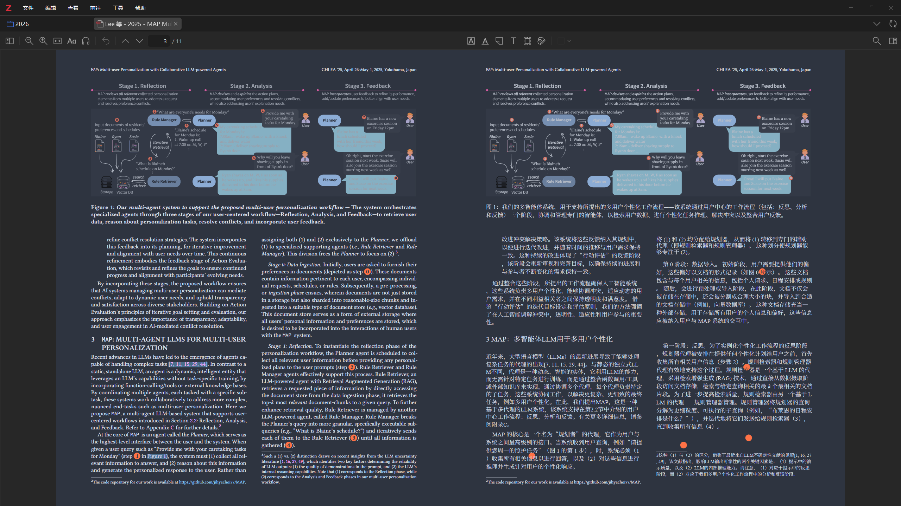

# Zotero PDF2ZH Bilingual

Zotero PDF2ZH Bilingual 是一个面向 Zotero 7 / 8 / 9 / 10 的本地 PDF 翻译插件，底层使用 [PDFMathTranslate](https://github.com/PDFMathTranslate/PDFMathTranslate) 完成高质量 PDF 文档翻译，并支持本地 Ollama 或其他 OpenAI 兼容大模型服务接口。

它的目标是尽量保持本地工作流：在 Zotero 中直接发起翻译，调用本地 Python 环境中的 `PDFMathTranslate`，生成单语或双语 PDF，并将结果重新导入 Zotero。



## 参考说明

本项目在插件结构、部分交互流程以及 Zotero 插件工程组织方式上参考了 [zotero-immersivetranslate](https://github.com/immersive-translate/zotero-immersivetranslate) 项目，并在此基础上重构为面向本地 `PDFMathTranslate` 工作流的实现。

## 功能特性

- 基于本地 `PDFMathTranslate` Python 环境执行 PDF 翻译
- 支持本地模型服务
  - Ollama
  - 其他 OpenAI 兼容接口
- 支持单语翻译 PDF 与双语 PDF
- 支持双语 PDF 排版方式
  - `PDFMathTranslate` 原始交替页
  - 插件后处理的同页左右对照
- 支持自定义兼容 `PDFMathTranslate` 的提示词模板
- 集成 Zotero 任务队列，可批量翻译 PDF

## 运行要求

- Zotero 9
- 可用的 [PDFMathTranslate](https://github.com/PDFMathTranslate/PDFMathTranslate) Python 环境 (`pip install pdf2zh`)
- 可用的本地模型服务，例如 Ollama

## 安装与配置

1. 准备好可运行的 `PDFMathTranslate` Python 虚拟环境。
2. 在 Zotero 中安装本插件。
3. 打开插件设置，填写 `Python path`。
4. 填写本地模型接口地址和模型名称。
5. 选择目标语言、源语言、翻译模式等参数。

## 关于 Python 路径

`PDFMathTranslate` **可以放在任意目录**，并不要求和插件发布包位于同级目录。

插件真正依赖的是你在设置中填写的 `python.exe` 路径，只要这个解释器所在环境中已经正确安装并可运行 `PDFMathTranslate` 即可。

默认值 `./PDFMathTranslate/.venv/Scripts/python.exe` 只是一个方便的相对路径示例。

如果你的 `PDFMathTranslate` 安装在别的位置，也完全可以直接填绝对路径，例如：

```text
D:\tools\PDFMathTranslate\.venv\Scripts\python.exe
```

## 设置说明

### 翻译模式

- `translation`：输出单语译文 PDF
- `dual`：输出双语 PDF

### 双语显示方式 / 双语 PDF 排版

这些设置只在 `dual` 模式下生效。

- `双语显示方式`：决定原文和译文在双语页面中的排列方向
- `双语 PDF 排版`：决定保留 `PDFMathTranslate` 的交替页，还是由插件后处理为同页左右对照

## 关于系统代理导致的 502

如果系统开启了全局代理，某些本地模型请求虽然目标地址是 `127.0.0.1` 或 `localhost`，仍然可能被代理劫持，最终在 `PDFMathTranslate` 翻译过程中表现为 `502`。

这个插件已经在调用本地 Python `PDFMathTranslate` 时主动做了处理：

- 清除这些代理环境变量：
  - `HTTP_PROXY`
  - `HTTPS_PROXY`
  - `ALL_PROXY`
  - `http_proxy`
  - `https_proxy`
  - `all_proxy`
- 同时显式设置：
  - `NO_PROXY=127.0.0.1,localhost`
  - `no_proxy=127.0.0.1,localhost`

也就是说，插件在直连本地 `PDFMathTranslate` / 本地模型链路时，会尽量避免系统代理影响本地回环地址请求。

如果你仍然遇到 `502`，建议继续检查：

1. 本地模型接口地址是否使用 `127.0.0.1` 或 `localhost`
2. 手动在该 Python 环境中调用 `PDFMathTranslate` / 模型接口是否正常
3. 你的模型名称、接口地址、Ollama 或 OpenAI 兼容模式是否配置正确

## 构建

```bash
npm install
npm run build
```

构建完成后，插件安装包会输出到 `dist/` 目录。

## 首发版本说明

`v0.1.0` 计划作为第一个公开发布版本。

当前范围：

- 本地 `PDFMathTranslate` Python 直连调用
- 本地模型 API 支持
- 单语与双语 PDF 输出
- 插件侧同页双语对照后处理

当前边界：

- 依赖用户本地已有可运行的 `PDFMathTranslate` 环境
- 同页双语对照是插件对 `PDFMathTranslate` 双语输出的后处理，不是 `PDFMathTranslate` 原生直接输出

## 仓库地址

- Repository: `https://github.com/hanbinhsh/zotero-pdf2zh-bilingual`
- Issues: `https://github.com/hanbinhsh/zotero-pdf2zh-bilingual/issues`

## 许可证

AGPL-3.0-or-later

---

**Developed with ❤️ by IceRinne**
